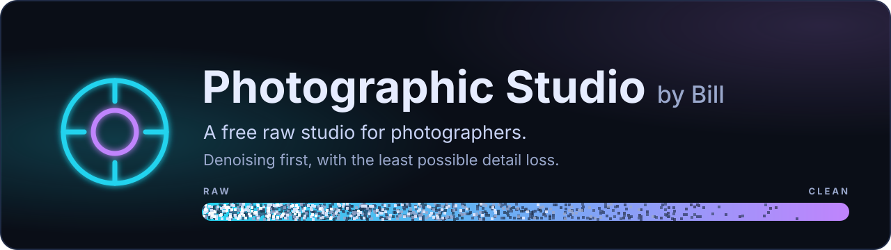

<p align="center">
  
</p>

<p align="center">
  
  <a href="LICENSE"></a>
  <a href="profiles/LICENSE.md"></a>
  
  
</p>

---

## Why this exists

Good raw software costs money, often every year. **Photographic Studio By Bill** is for photographers who can't pay for it, or would rather not: free, open source, and built to get the most out of every raw file.

It starts with the hardest job: cleaning high-ISO noise **without smearing the detail** you shot. From there it grows into a full raw studio.

One raw file in, one finished file out. Your photos never leave your PC.

## What it does, and what's coming

| | Feature | What it means for you |
|:-:|---|---|
| ✅ | **Raw Analyzer** | Measures your camera's noise, banding and hot pixels from any raw file, and shows it all in a visual report. |
| 🧪 | **Import from card and the Library** | Copy a card into your own Photos folder, a folder per shooting day named by the date (or your name for the shoot), every file checked, the card never changed. Then look through the raws, rate and pick with the keyboard, check focus at 100%, compare two side by side, and export your picks in one go, without opening Windows Explorer. |
| ✅ | **Develop engine** | Turns raw files into 16-bit Adobe RGB TIFFs (or PNG / JPEG), and builds a page comparing each result with your camera's own JPEG. |
| 🎨 | **Calibration wizard** | Teach the tool your camera: print a checklist, shoot about 120 frames, drop them in. |
| 🎨 | **Lens wizard** | Teach it your lenses, including vintage lenses with no electronic contacts. |
| 🧪 | **High-ISO denoiser** | Cleans noise in the raw data itself, before anything is clipped, smeared or tinted: that is where it works best, so shoot raw for the cleanest results. Scans and JPEGs can be cleaned too, from noise measured in the picture itself (good on grain and colour mottling; it cannot undo what the camera already smeared or compressed). |
| 🧪 | **Automatic lens correction** | One **Fix lens** button: colour fringing, distortion (from a lens profile or from straight lines in the photo) and falloff, fixed automatically, even for vintage lenses with no contacts. Purple-fringe removal is on by default; vignetting correction stays off unless you want it. |
| 🧪 | **Develop controls** | Exposure, light and tone curve, white balance, colour wheel, HSL and grading, looks, straighten, perspective and crop, masks (brush, gradient, radial, object, colour, depth, people), retouch and portrait tools, virtual copies, snapshots and a history you can step back through. |
| 🧪 | **Detail by scale (microcontrast)** | More shades of shadow: the quality great lenses are loved for. One Amount and a Balance from tonal to crisp, or six methods you can dial in and combine. No halos, noise is not lifted as detail, and you can judge it in black and white. |
| 🧪 | **Auto HDR** | One tick, then Light, Medium, Heavy, Highlights only, Low-key or Shadows only: opens shadows and holds highlights without flattening the photo. Never on unless you turn it on. |
| 🧪 | **Recover lens sharpness** | Undoes part of the measured blur by deconvolution, without ringing. Off for lenses you mark as character lenses. |
| 🧪 | **Old photos, scans and film** | Opens TIFF, JPEG and PNG scans beside your raws and shows them exactly as they are. Turns black and white or colour negatives into positives (from scans or camera copies), takes stains and corrosion out by unmixing them from the picture (where a stain has eaten the picture, it shows you instead of inventing), removes dust and scratches with Microsoft's scratch detector plus the Studio's own filter, and can colourize a black and white photo with DDColor (downloaded once, runs on your PC). Faces are never redrawn. |
| 🧪 | **Cognitive Adjustments** | The Studio's own answer to Photoshop's Neural Filters, built from research papers and run on your PC. Each tool measures what is in the photo and invents nothing: printing-dot removal for scans of printed pictures, colourize with evened input and colour balance, a heat map of what every automatic tool changed, depth from one photo (Depth haze, a depth view, and Masks > Depth to select by distance), click-to-select with Meta's SAM 2.1 (Tiny shipped; Large made on your PC by `Convert Models.bat`), colour match from another photo (solved as ordinary slider settings you can still move), JPEG repair (the smoothest picture that still matches the file exactly), Relight (move the light using the shapes in the depth map) and Composite (click a subject out of another photo, place it, match its colours and grain). |
| 🧪 | **Focus Stack** | Merges photos focused at different distances into one photo sharp from front to back, with a depth map you can look at. Handles focus breathing, and a hand-held stack when Line up locally is on. Four ways to merge, each saying what it is good and weak at, and a halo guard. |
| 🧪 | **Card to Stacks** | Point it at a card or a folder: it finds every focus stack, leaves out the frames that would hurt each one with the reason (soft everywhere, adds nothing, shaken, subject moved), shows what is in focus and what missed, and stacks them all. Bursts (AI Servo action too) and single shots are left alone. Nothing is deleted. |
| 🧪 | **Super-Res Stack** | Merges a burst into one cleaner photo, or a 1.5x or 2x larger one when the frames moved a little between shots (drizzle, from the raw data itself). Modes for hand-held bursts, a tripod, the moon and the night sky (stars lined up, planes and satellites thrown out). A coverage chart tells you honestly whether the extra resolution was really there. |
| 🧪 | **Dual Pixel Lab** | Opens Canon Dual Pixel RAW files and shows what the two half-pixels saw: the two views, a depth map, a 3D wigglegram, anaglyph or side-by-side pair, and up to a stop of highlights the normal image clipped. Checked on the EOS R5; the 5D Mark IV's files are not checked yet. |
| 🧪 | **Infrared / Full Spectrum** | Its own tab for converted cameras: guesses the filter from the raw (590, 665, 720, 850, full spectrum) and says how sure it is, white balance far beyond the camera's range (auto foliage, click foliage, a filter measured once), looks (swap red and blue, blue sky, Goldie, colour-infrared film), black and white from the channels with a live noise meter, 850 nm raws developed without demosaicing, hot-spot correction, colour by brightness, and visible + infrared fusion (NDVI). |
| 🧪 | **Panorama** | Stitches overlapping frames into one photo that does not look stitched: finds the layout and the focal length (even for a manual lens), measures distortion and vignetting from the overlaps, evens out exposure, cuts seams where the frames agree, keeps the frame without lens flare where two overlap, and blends them. Rectilinear, cylindrical, spherical (360), Panini and Mercator. |
| 🧪 | **Flare removal and Fill** | Finds lens-flare ghosts (worst in infrared) and takes their glow away, keeping the detail under it, or rebuilds them. **Fill** in Retouch rebuilds anything you brush over (a wire, a sign, a person) from what is around it: real texture from your photo, planned by the LaMa generative model when you add it with `Convert Models.bat`. |
| 🗺️ | **Render like my lens** | A shared library of real lens signatures. |
| 🗺️ | **Photoshop and PhotoCraft** | Send to Photoshop or PhotoCraft in one click, plus a Photoshop panel. |
| 🧪 | **Every brand** | Built and tuned on Canon. Raws from Nikon, Sony, Pentax, Panasonic, Olympus and other Bayer-sensor cameras open too; tell us how yours looks. Fujifilm X-Trans is still to come. |

✅ works today · 🧪 experimental preview · 🎨 designed · 🗺️ planned

**Output:** 16-bit TIFF in Adobe RGB by default; 8- or 16-bit PNG and JPEG too, in Adobe RGB, sRGB, ProPhoto RGB or Display P3, resized and sharpened for screen or print if you like. Every export is named after its photo with `_Studio` added (`IMG_0001.CR2` becomes `IMG_0001_Studio.tif`), so it never has the name of your original or of the camera's own JPEG.

## Cameras

Canon **CR2** and **CR3** come first: the Studio is built and checked on files from the **EOS R5**, **5D Mark IV** and **6D**. Raw files from other makers with an ordinary (Bayer) sensor open as well (Nikon NEF, Sony ARW, Pentax PEF, Panasonic RW2, Olympus ORF, DNG and more), with noise estimated from each photo until that camera has a profile. Not yet: Fujifilm X-Trans, Sigma Foveon, Canon sRAW / mRAW and some newer compressed formats (the Studio says so when you open one). Anyone will be able to calibrate their own camera with the wizard.

## Install

**Easiest (recommended):** download **[Install-Photographic-Studio.bat](https://github.com/photogbill/Photographic_Studio_By_Bill/releases/latest/download/Install-Photographic-Studio.bat)** and double-click it.
- A window opens for you to pick where the Studio goes: any drive or folder (it starts at D: if your PC has a second internal drive with room). It then downloads everything into that one folder, including its own private copy of Python. It needs about 1.5 GB.
- No git, no Python install, no admin rights. Nothing is installed anywhere else on your PC; the only thing outside the folder is a desktop shortcut, and only if you say yes.
- Run it again at any time to update. Your settings, calibrations and photos are kept.

**Prefer a classic installer?** Download **[Photographic-Studio.msi](https://github.com/photogbill/Photographic_Studio_By_Bill/releases/latest/download/Photographic-Studio.msi)** from the [Releases page](../../releases/latest). It is bigger (Python and every package are inside), installs for your Windows account only, and shows up in Settings > Apps with an Uninstall button.

**Linux:** download **[install-linux.sh](https://github.com/photogbill/Photographic_Studio_By_Bill/releases/latest/download/install-linux.sh)**, then in a terminal run `bash install-linux.sh`.
- It asks where to put the Studio (`~/Photographic-Studio` unless you pick another folder) and downloads everything into that one folder. It uses your own Python 3.10 or newer, or downloads a private copy if yours is too old.
- No root for the Studio itself. If the window needs system libraries your PC lacks (often `libxcb-cursor0`), it names them and asks before installing them with your package manager; that one step asks for your password.
- It offers an applications-menu entry; otherwise start it with `start-studio.sh` in the folder. Run the installer again at any time to update.
- Works on glibc Linux for x86_64 and ARM64 (Ubuntu, Mint, Debian, Fedora, openSUSE, Arch and similar), including Bazzite and other Fedora Atomic systems: everything goes in your home folder, and use Desktop Mode, not Game Mode. Not on Alpine (musl).

Windows may show a blue **"Windows protected your PC"** box for either file. That is because the Studio is not code-signed (signing costs money every year, and this is a free project). Click **More info**, then **Run anyway**.

**Updates:** in the Studio, **Help > Check for updates**. It is off until you turn it on. When it is on, the Studio asks GitHub for the newest version number (nothing else is sent, never a photo) and can put the new version in place for you.

## Using it

- **Start Studio.bat** (or the desktop shortcut) opens the Studio; on Linux, `start-studio.sh` or the menu entry.
- Drag **CR2** or **CR3** files, or a whole folder, onto **Analyze Raws.bat** for a report on your camera's files.
- Drag raw files onto **Develop Raws.bat** to develop them. Your TIFFs and the comparison page land in the `outputs` folder.
- **studio-cli.bat** is for other programs, not for double-clicking: it runs every editing tool from the command line and answers in JSON (see `docs/CLI.md`).
- **Convert Models.bat** turns model downloads in the `models` folder into the Studio's format on your PC (SAM 2.1 Large for click-to-select, which is too big to ship; or a newer depth model). It checks each one runs and logs to `logs\convert_models.log`.

**Developers:** clone the repository with git and double-click **Install.bat** (on Linux: `bash install-linux.sh` inside the clone). It uses your own Python (3.10 or newer) in a private environment inside the folder, or downloads a private copy of Python if your PC has none. Installers never overwrite a git copy.

## Connect an AI model (MCP)

The Studio can be used by an AI model as well as by you. It speaks the [Model Context Protocol](https://modelcontextprotocol.io) (MCP), the open standard AI apps use to reach tools, so a model can develop, clean, colour match, cut out, make depth maps and stack your pictures when you ask it to. This is optional and off until you set it up.

**Claude desktop app (Windows):**

1. Double-click **Connect Studio to Claude.bat** and press **C**. It adds one entry to Claude's own settings file and keeps a copy of the file as it was.
2. Quit Claude completely (also from the tray, near the clock) and start it again.
3. Ask Claude to do something with a picture, giving it the file's path: *"Clean D:\Photos\IMG_0001.CR3 and show me a preview."*

To undo it, run the same file and press **D**.

**Any other MCP client** (or setting Claude up by hand): add a local (stdio) server that starts the Studio's own Python with `-m studio.mcp_server`. This prints the exact entry for your copy:

```
"python\python.exe" tools\connect_claude.py --print
```

(a git copy uses `.venv\Scripts\python.exe`; on Linux, `.venv/bin/python tools/connect_claude.py --print`). It looks like this:

```json
{
  "mcpServers": {
    "photographic-studio": {
      "command": "D:\\Photographic Studio\\python\\python.exe",
      "args": ["-m", "studio.mcp_server"],
      "env": { "PYTHONPATH": "D:\\Photographic Studio", "PYTHONUTF8": "1" }
    }
  }
}
```

In the Claude desktop app that file is `claude_desktop_config.json`. On Windows the app reads it from `%LOCALAPPDATA%\Packages\Claude_...\LocalCache\Roaming\Claude\` (the connect file finds it for you; Settings > Developer > Edit Config can open a different copy the app ignores). `studio-mcp.bat` starts the same server, for clients that want one command with no arguments. A copy installed with the MSI installer cannot be connected yet; use the one made by **Install Photographic Studio.bat**.

**What the model gets:** one tool per Studio command (`studio_edit`, `studio_clean`, `studio_match`, `studio_depth`, `studio_cutout`, `studio_find`, `studio_stack` ...), `studio_schema` (every setting and what it does) and `studio_view` (look at a picture). The full list and the rules are in `docs/CLI.md`.

**What it can and cannot do:** it can read the pictures you point it to and write new files, always under a new name ending in `_Studio`. It cannot replace, move or delete a photo, and it never overwrites a file the Studio did not write.

**Your privacy, plainly:** the editing happens on your PC. But when a model *looks* at a picture (a preview, or `studio_view`), that small picture is sent to the company that runs the model, exactly as if you had attached it to a chat. If a photo must not leave your PC, do not ask a model to look at it.

## Your photos stay yours

- Your photos are **never** uploaded by the Studio. (If you connect an AI model, the pictures you ask it to look at go to that model: see above.)
- Later, you'll be able to share your camera's or lens's **profile** so others benefit. A profile is numbers, never pictures. Sharing is **off** until you turn it on, and you read the exact file before it goes.
- Never shared: photos, camera and lens serial numbers, your sensor's fingerprint, hot-pixel and dust maps, or your location.

## Help build it

- **Found a bug?** [Open an issue](../../issues). In the Studio, **Help > Copy diagnostic report** puts everything we need on the clipboard (versions and the end of the log; never a photo, a serial number or a location): paste it into the issue. Or attach `studio.log` from the `logs` folder.
- **Coming soon:** camera and lens profiles from the community. Every shared profile stays open under CC BY-SA 4.0, so the library belongs to everyone.

## Licence

- **Software:** [GNU GPL v3.0](LICENSE). Free to use, change and share. Anything built from it must stay free and open too.
- **Lens and camera profiles:** [CC BY-SA 4.0](profiles/LICENSE.md).

---

<p align="center">
  Made by Bill (<a href="https://github.com/photogbill">photogbill</a>), for every photographer who can't pay for the big names.
</p>
